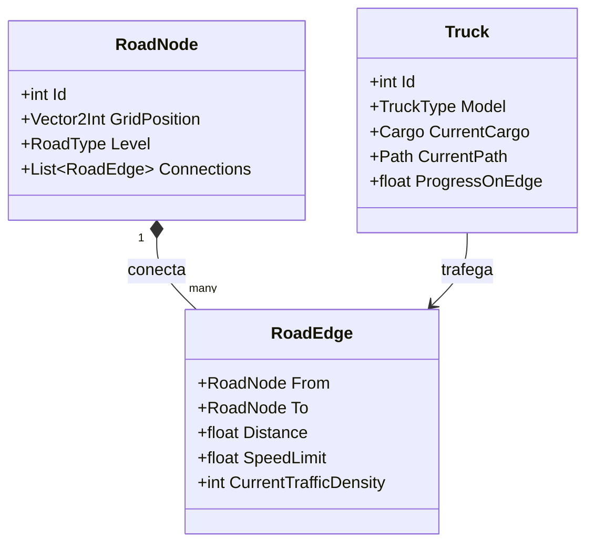

# 🏛️ Transit Empire — Especificação Arquitetural e Engenharia de Software

Este documento define a arquitetura técnica de longo prazo para o **Transit Empire**, priorizando **escalabilidade sem gargalos**, **código limpo e desacoplado**, **testabilidade** e **longevidade do projeto**.

---

## 1. Princípio Arquitetural Central: Desacoplamento Headless

Em jogos de simulação em larga escala (referências como *Factorio*, *RimWorld* e *Transport Fever*), misturar a lógica de simulação com a engine gráfica é a principal causa de gargalos de desempenho e código espaguete.

Por isso, adotamos uma **Arquitetura em Duas Camadas Estritas**:

```mermaid
flowchart TD
    subgraph Core ["1. Core de Simulação (Headless / Agnóstico de Engine)"]
        Grid["Malha de Dados (Grid Data & Nós Viários)"]
        ProcGen["Gerador Procedural (Terreno, Cidades & Estradas)"]
        Economy["Economia, Armazéns & Demandas"]
        UrbanGrowth["Mecanismo de Expansão Urbana Randômica"]
        FleetSim["Simulador de Caminhões & Pathfinding"]
    end

    subgraph Interface ["2. Camada de Comunicação / Estado"]
        State["Snapshot de Estado Determinístico (Tick-based)"]
        Events["Fila de Eventos (Ex: VeículoChegou, CidadeExpandiu)"]
    end

    subgraph Client ["3. Camada de Apresentação Gráfica (View)"]
        Renderer["Renderizador 3D / Isométrico (Shaders, Modelos, Câmera)"]
        UI["Interface do Usuário (Painéis, Níveis, Botões de Upgrade)"]
        Audio["Sistema de Áudio & Efeitos"]
    end

    Core -->|Exporta a cada Tick| Interface
    Interface -->|Interpolação Suave| Client
    Client -->|Comandos do Jogador (Ex: Upgrades, Compras)| Core
```

### Vantagens Desta Abordagem:
1. **Zero Gargalo Gráfico na Simulação:** A simulação roda em passos de tempo fixos (*ticks*), permitindo cálculos multithread em segundo plano sem travar a taxa de quadros (FPS) da renderização.
2. **Testabilidade Automatizada:** O jogo pode ser testado por scripts de simulação sem precisar abrir nenhuma janela gráfica (testando equilíbrio econômico, rotas e estresse de 50.000 caminhões em milissegundos).
3. **Portabilidade:** A engine gráfica pode ser atualizada ou até substituída sem perder uma única linha da lógica de simulação.

---

## 2. Estrutura de Dados da Malha Viária (Otimizada para Escala)

Para que milhares de caminhões naveguem sem consumir excesso de CPU:



* **Separação Grid vs. Grafo:** O mapa é uma matriz de células (*Grid*) para renderização e expansão de prédios, mas os caminhões trafegam sobre um **Grafo Direcionado de Arestas (*RoadEdge*)**.
* **Pesos Dinâmicos:** A velocidade máxima permitida de cada aresta varia com o nível de upgrade (Terra: 30 km/h; Asfalto: 70 km/h; Dupla: 110 km/h). O pathfinding considera o tempo de viagem e o congestionamento para calcular o trajeto mais rápido.

---

## 3. Avaliação Técnica da Stack Recomendada

Como você não possui engines instaladas no momento e busca um projeto muito bem executado:

### Opção 1: **C# Moderno (.NET 8/9 SDK) + Godot 4 (.NET)**
* **Por que é excelente:**
  * O .NET moderno compila via JIT de altíssima performance com suporte a `structs`, alocação zero em memória e multithreading avançado.
  * O Godot 4 é extremamente leve (um executável de ~100MB, sem instaladores pesados de dezenas de gigabytes como Unreal/Unity), aberto, e tem um renderizador Vulkan moderno perfeito para o estilo estilizado/tilt-shift.
  * Facilidade de instalação limpa e automatizada via `winget`.

### Opção 2: **Rust puro (Simulação) + Bevy ou Raylib**
* **Por que é excelente:**
  * Máximo desempenho absoluto da máquina, livre de Garbage Collection (GC).
  * Ideal para quem prioriza engenharia de sistemas em nível extremo de performance, embora a curva de desenvolvimento da interface visual seja mais lenta.

---

## 4. Próximas Etapas Metodológicas (Planejamento Estruturado)

1. **Etapa 1: Definição dos Modelos de Domínio e Contratos de Dados (Core Models)**
   * Definição exata das estruturas de dados: `City`, `Industry`, `RoadSegment`, `Truck`, `Warehouse`, `Resource`.
2. **Etapa 2: Implementação do Algoritmo de Geração Procedural da Malha**
   * Distribuição espacial com ruído e conexão das cidades/indústrias via algoritmo gerador de estradas iniciais.
3. **Etapa 3: Sistema de Expansão Urbana Procedural**
   * Lógica pela qual a cidade decide aleatoriamente onde e quando expandir quarteirões e novas ruas ao atingir metas de abastecimento.
4. **Etapa 4: Setup da Infraestrutura de Ferramentas**
   * Instalação limpa dos SDKs selecionados e montagem da estrutura de pastas do repositório.
