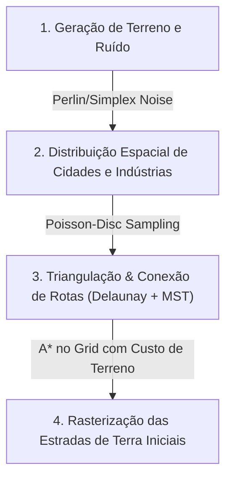
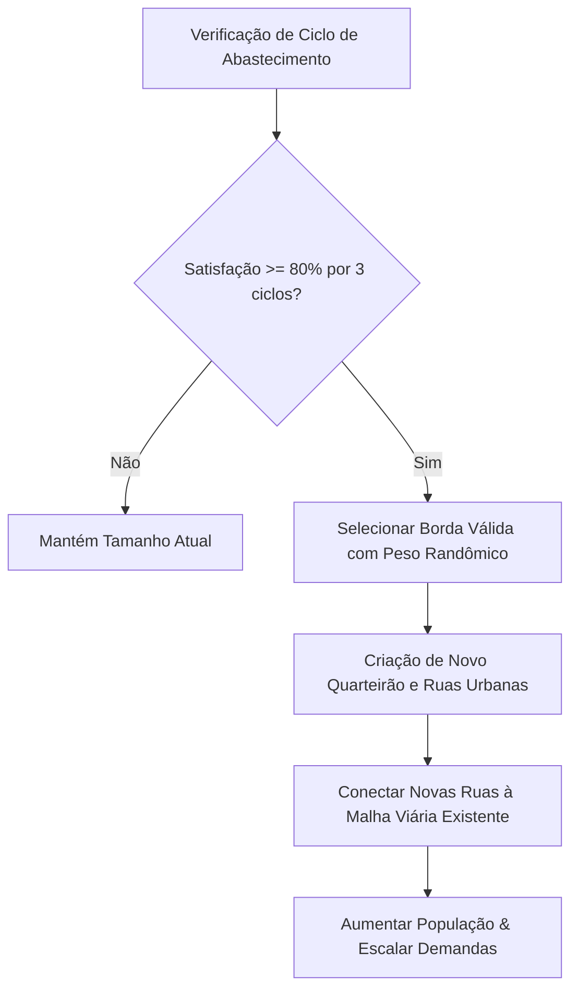

# 📐 Transit Empire — Modelos de Domínio e Especificação Algorítmica

Este documento detalha as estruturas de dados fundamentais e os algoritmos formais que regem a geração do mundo procedural, a malha viária e a expansão randômica das cidades.

---

## 1. Modelos de Domínio (Domain Models)

A simulação é modelada de maneira orientada a dados (*Data-Oriented*), garantindo eficiência de memória, isolamento de efeitos colaterais e facilidade de serialização (Save/Load).

### 1.1. Células do Grid e Tipos de Terreno
```csharp
public enum TerrainType : byte {
    Plains,
    Forest,
    Hills,
    Mountain, // Inacessível para estradas convencionais
    Water     // Requer pontes
}

public enum RoadTier : byte {
    None = 0,
    Dirt = 1,       // 30 km/h - inicial gerada pelo jogo
    Gravel = 2,     // 45 km/h
    Asphalt = 3,    // 70 km/h
    Highway = 4,    // 90 km/h
    DualCarriage = 5// 110 km/h - pista dupla expressa
}

public struct GridCell {
    public int X;
    public int Y;
    public TerrainType Terrain;
    public RoadTier RoadLevel;
    public int OccupantEntityId; // ID da Cidade, Indústria, Armazém ou Garagem (0 se vazio)
}
```

### 1.2. Grafo Viário (Topologia para Pathfinding)
O grid representa o espaço físico, mas os veículos trafegam sobre um **Grafo Direcionado**:
```csharp
public class RoadNode {
    public int Id;
    public Vector2Int GridPosition;
    public List<RoadEdge> OutgoingEdges;
}

public class RoadEdge {
    public int Id;
    public RoadNode FromNode;
    public RoadNode ToNode;
    public RoadTier Tier;
    public float LengthKm;
    public float SpeedLimitKmh => Tier switch {
        RoadTier.Dirt => 30f,
        RoadTier.Gravel => 45f,
        RoadTier.Asphalt => 70f,
        RoadTier.Highway => 90f,
        RoadTier.DualCarriage => 110f,
        _ => 10f
    };
    public int ActiveVehicleCount; // Para cálculo de congestionamento
}
```

### 1.3. Cidades e Armazéns
```csharp
public class City {
    public int Id;
    public string Name;
    public Vector2Int CenterPosition;
    public HashSet<Vector2Int> UrbanTiles; // Ruas e quarteirões ocupados pela cidade
    public int Population;
    public CityWarehouse Warehouse;
    public float SupplySatisfactionRate;  // 0.0 a 1.0 (0% a 100%)
    public int CyclesAboveSatisfactionThreshold;
}

public class CityWarehouse {
    public int CapacityPerResource;
    public Dictionary<ResourceType, int> StoredStock;
    public Dictionary<ResourceType, int> DailyConsumptionDemand;
}
```

### 1.4. Veículos e Frotas
```csharp
public class Truck {
    public int Id;
    public string LicensePlate;
    public TruckModel Model;
    public ResourceType CarryingCargo;
    public int CurrentCargoAmount;
    public int MaxCapacity;
    
    // Navegação e Estado Mecânico
    public RoadEdge CurrentEdge;
    public float DistanceAlongEdgeKm;
    public Queue<RoadEdge> RoutePath;
    public TruckStatus Status; // Traveling, Loading, Unloading, Idle
    public float Condition;    // 0.0 a 100.0% (Penaliza velocidade se < 30%)
}
```

### 1.5. Clima Dinâmico, Hubs Logísticos e Contratos Licitatórios
```csharp
public enum WeatherCondition : byte {
    Clear = 0, // Aderência de 100% em todas as vias
    Rain = 1   // Chuva Tropical: reduz velocidade em Terra (-40%) e Cascalho (-15%)
}

public sealed class LogisticsHub {
    public int Id;
    public string Name;
    public GridCoordinate Position;
    public float TariffBonusMultiplier; // +20% nas entregas no raio de cobertura
}

public sealed class LogisticsContract {
    public int Id;
    public int TargetCityId;
    public ResourceType Resource;
    public int RequiredAmount;
    public int DeliveredAmount;
    public decimal BonusRewardMoney;
}
```

---

## 2. Algoritmo 1: Geração Procedural do Mundo & Malha Inicial

A geração randômica ocorre em 4 passos determinísticos baseados em uma semente (*Seed*):



### Detalhamento dos Passos:
1. **Geração de Terreno:**
   * Utiliza ruído Simplex com 3 oitavas para determinar elevação e umidade, definindo planícies, morros, florestas e corpos d'água.
2. **Posicionamento de Cidades e Indústrias:**
   * Algoritmo de *Poisson-Disc Sampling* para garantir que cidades fiquem a uma distância mínima equilibrada (ex: mínimo de 15 a 20 células de distância entre cidades).
   * As indústrias primárias (Fazendas, Serrarias, Minas) são posicionadas nas cercanias das cidades ou biomas correspondentes (Floresta para Serraria, etc.).
3. **Topologia Viária Inicial (Delaunay + MST):**
   * Computa a triangulação de Delaunay entre os centros de todas as cidades e indústrias.
   * Aplica o algoritmo de **Kruskal ou Prim (Árvore Geradora Mínima / MST)** para garantir que todos os pontos estejam conectados sem estradas redundantes desnecessárias.
   * Adiciona aleatoriamente 15% a 20% das arestas descartadas da Delaunay para criar circuitos alternativos e evitar um mapa puramente linear.
4. **Rasterização das Estradas no Grid:**
   * Cada conexão lógica é traçada no grid utilizando **A\*** com função de custo baseada no relevo (evitando picos íngremes ou contornando lagos).
   * As células atravessadas recebem `RoadTier.Dirt` (Estrada de Terra).

---

## 3. Algoritmo 2: Expansão Urbana Randômica das Cidades

Conforme o jogador cumpre as demandas de abastecimento nos armazéns, a cidade cresce organicamente:



### Regras de Crescimento da Cidade:
1. **Critério de Expansão:** Quando `SupplySatisfactionRate >= 0.80` por 3 ciclos consecutivos de simulação.
2. **Seleção de Vetor de Expansão:**
   * O algoritmo analisa as células adjacentes à borda externa da cidade atual (`UrbanTiles`).
   * Filtra apenas terrenos compatíveis (Planícies, colinas baixas; rejeita água e montanhas).
   * Sorteia aleatoriamente um nó de borda com peso orientado para formar quarteirões coesos (evitando formatos espalhados e irreais).
3. **Criação de Novas Ruas:**
   * O jogo gera automaticamente 2 a 4 células de rua urbana no grid conectadas à malha existente.
   * Essas novas ruas são adicionadas ao `RoadGraph` com `RoadTier.Dirt` ou `RoadTier.Asphalt` urbano, permitindo tráfego imediato.
4. **Impacto Econômico:**
   * A população da cidade aumenta proporcionalmente ao novo quarteirão (+15% a +25%).
   * Aumenta a demanda de consumo diário nos armazéns municipais, exigindo mais viagens ou caminhões de maior capacidade.

---

## 4. Algoritmo 3: Mecânica de Upgrade Viário pelo Jogador

Quando o jogador investe fundos para melhorar um trecho de estrada:
1. O jogador seleciona uma célula de estrada ou arrasta uma linha ao longo de um trecho conectado.
2. O sistema calcula o custo total:
   $$\text{Custo Total} = \sum_{i=1}^{n} \text{CustoUpgrade}(\text{NívelAtual}_i \rightarrow \text{NívelDesejado}_i)$$
3. Se o jogador tiver saldo suficiente:
   * A célula física no grid é atualizada visualmente (textura/mesh de asfalto, rodovia, etc.).
   * A respectiva `RoadEdge` no `RoadGraph` tem seu limite de velocidade (*SpeedLimitKmh*) e capacidade aumentados instantaneamente.
   * Os caminhões em trânsito recalculam sua velocidade máxima no próximo tick de simulação ao entrar no trecho melhorado.
